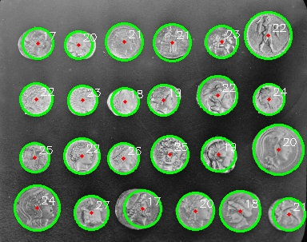

# Coin Detection and Recognition

Two classical computer vision exercises for coin images. The detector locates circular boundaries with a custom Hough transform. The classifier uses a custom histogram of oriented gradients (HOG) and a linear SVM to identify the denomination and side of pre-cropped Turkish coins.



The numbers beside the centers are **Hough votes**. The example photo contains Greek coins and demonstrates detection. The Turkish denomination experiment uses its own labeled data.

## Quick start

Requires Python 3.10+. Run these commands from the repository root in an activated virtual environment.

```bash
python -m pip install -r requirements.txt
python src/coin_pipeline.py detect --image examples/coins.png --output outputs/detected.jpg --min-radius 14 --max-radius 34 --radius-step 1 --threshold 17 --sigma 2.5
```

The supplied photo produces 24 circle candidates with these settings. The radius bounds are in pixels. Smaller steps sample more radii and cost more time. The detector uses grayscale Canny edges, votes for center candidates, keeps local peaks, and suppresses near-duplicate circles across radii. It works best with individually visible, approximately circular boundaries.

## Classify Turkish coin crops

Arrange already-cropped coins in two directories. The filename prefix supplies the class. Supported denominations are `1kr`, `5kr`, `10kr`, `25kr`, `50kr`, and `1TL`, each with `_obverse` and `_reverse`.

```text
data/
├── train/
│   ├── 1TL_obverse_001.jpg
│   └── 50kr_reverse_001.jpg
└── test/
    ├── 1TL_obverse_020.jpg
    └── 50kr_reverse_020.jpg
```

```bash
python src/coin_pipeline.py classify --train data/train --test data/test
python -m unittest discover -s tests
```

The classifier resizes each crop to 128 × 128, accumulates unsigned orientation histograms, applies L2-Hys block normalization, and reports test precision, recall, F1, and support. Keep photographs of the same physical coin in one split to avoid overstating generalization. The original Turkish coin dataset is required to reproduce its classification results.

## Credits

The detection image is from the Brooklyn Museum collection via [scikit-image](https://scikit-image.org/docs/stable/api/skimage.data.html#skimage.data.coins), which records no known copyright restrictions. See [LICENSE](LICENSE) for the source code.

CI checks installation, dependency compatibility, unit tests and CLI examples on Python 3.12 for each push and pull request. You can also run it from the Actions tab.
